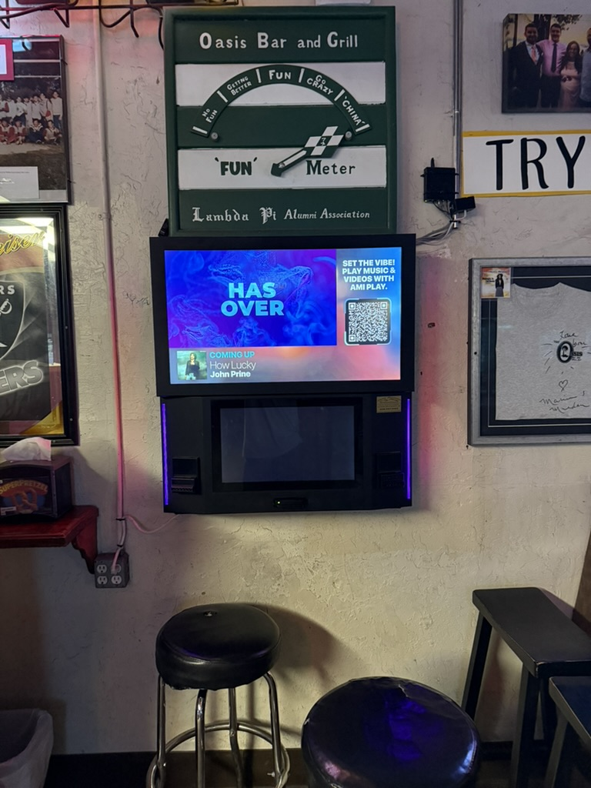
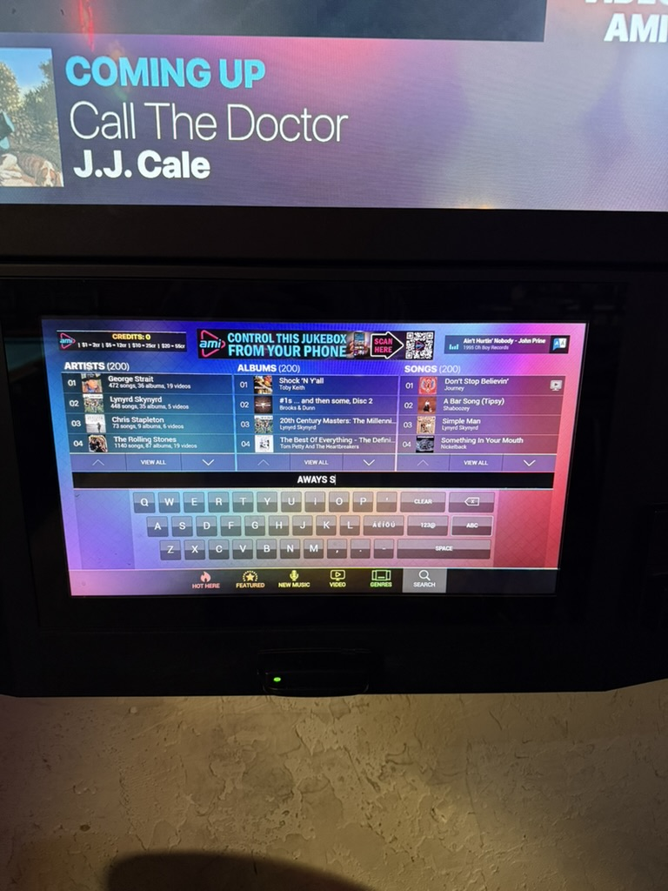
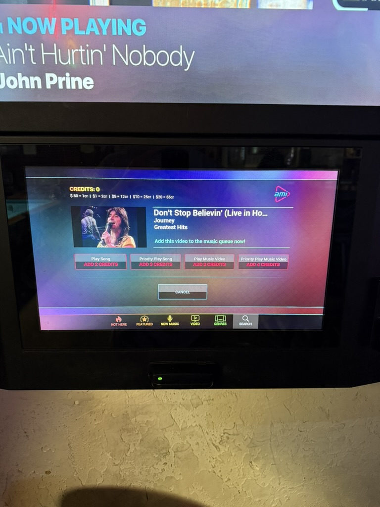

# The Oasis Jukebox Owes Me One Song

There's a pool bar near me called Oasis, and like a lot of bars, it has one of those touchscreen jukeboxes on the wall. You put money in, it gives you credits, and you spend the credits on songs. Simple enough, right? That's what I thought too.

## The night I got stuck with one credit

I was there on a weeknight with Mathew (roommate), and between games I walked over to put on some music. I fed in 5 and got 12 credits. I already knew what song I wanted to play, so I searched for it and queued it up. That one cost 2 credits.

Then I picked a second song, and it cost 3 credits, which was different from the first one. After picking a few songs, I was left with 1 credit, and that's where things got annoying.

No big deal, I figured. I'll just find a one-credit song. Except I couldn't. I scrolled through a bunch of artists, and every song I tapped cost more than one credit. There was no way to sort or filter by price, so the only way to learn what a song cost was to tap on it and wait. And waiting was a big part of this, because the machine is slow. Every tap took a second or two to respond, so I'd tap, stand there, wonder if it registered, and sometimes tap again.

After about 5 minutes of this, I gave up and went back to my game. I'd paid for that credit, and I couldn't use it. My options were to put in more money (and probably end up with leftover credits again) or just let it go.

## What went wrong

In class we talked about a **mental model**, which is basically the picture in your head of how something works. Walking up to the jukebox, I assumed every song would cost the same fixed amount, something like a dollar a song. That way I'd know exactly how many songs my money would get me before I even started picking. The Oasis jukebox doesn't work like that at all. Prices change from song to song, and nothing on the main screens prepared me for that. The machine was working the way it was designed to, but the way it was designed didn't match what most people would expect, and that's where the frustration started.

The second problem is what's called the **gulf of execution**. That's the gap between what you want to do and figuring out how to actually do it with the system in front of you. My goal was really simple: "spend my last credit on any song I can afford." But the jukebox gave me no way to do that. No price filter, no "songs you can afford" list, nothing. The only path was to tap songs one by one and hope, which turned a five-second task into a scavenger hunt.

Then there's **feedback**, which is how a system lets you know it heard you and what happened. When I tapped a song, the screen often just sat there for a moment. Was it loading? Did I miss the button? I couldn't tell, so I'd tap again. A slow machine is annoying on its own, but a slow machine that doesn't tell you it's working makes you second-guess every move.

I'll also say that leftover credits might not be totally an accident. Designers have a name for interfaces that nudge you into doing something that benefits the company more than you: a **dark pattern**. Uneven song prices plus credits that can't be refunded means a lot of people probably end up putting in more money just to use up what they have left. I don't know if that was the intent, but it's how it works out.

## To be fair

The idea behind it is great. Being able to pick almost any song from your phone-sized search screen in a bar is way better than the old jukeboxes with 50 CDs. The library is huge, and when your song finally comes on, it's honestly a little satisfying. Being able to pay with a credit card was also really convenient, since I almost never carry cash anymore. The core concept isn't the problem. It's the details around it.

## How I'd fix it

1. **Show the price everywhere.** Put the credit cost right next to every song in search results and lists, so you never have to tap in to find out.
2. **Add a "what can I afford?" filter.** If I have one credit left, let me see only one-credit songs. This alone would have solved my whole night.
3. **Let leftover credits carry over.** Tie them to a phone number or the bar's app so they're there on your next visit, instead of just vanishing.
4. **Respond to every tap instantly.** Even if the hardware is slow, a quick highlight or loading spinner tells people "got it, hang on" so they don't keep tapping.
5. **Clean up the screens.** Fewer cluttered menus and bigger buttons would make it easier to use in a dim, loud bar, which is exactly where it lives.

Next time I'm at Oasis, I'll probably still use the jukebox. I'll just be doing math before I put my money in.